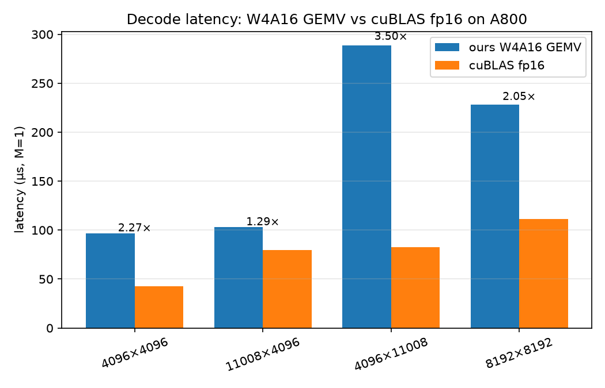
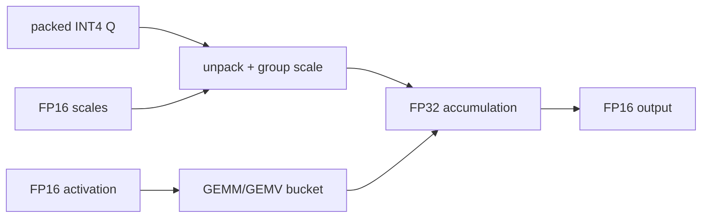

# W4A16 Quantized Inference Kernels in TileLang

This repository implements weight-only INT4 (W4A16) dequantization kernels in
[TileLang](https://github.com/tile-ai/tilelang), with a hand-written CUDA
baseline, an M=1 GEMV path, industrial int4pack comparison, and a full
DeepSeek-Coder-6.7B validation on an NVIDIA A800.

## Highlights

- Fused dequant GEMM with per-group fp16 scales and FP32 accumulation.
- Decode-specialized GEMV plus explicit effective-bandwidth accounting.
- Reproducible JSON results, pytest correctness tests, and a single Day 6–10 runner.
- End-to-end wrapper replacing 225 Linear layers in DeepSeek-Coder-6.7B.

## Results

Environment: NVIDIA A800 80GB (SM80), CUDA 12.8, PyTorch 2.7.0+cu128,
TileLang 0.1.15. Measurements exclude JIT compilation unless stated.

### Prefill GEMM, fp16 activation, group size 128

| M×N×K | fused v2 | two-stage | cuBLAS fp16 |
|---|---:|---:|---:|
| 512×4096×4096 | 0.28086 ms / 61.169 TFLOPS | 0.12504 ms | 0.09114 ms |
| 4096×4096×4096 | 1.75480 ms / 78.322 TFLOPS | 0.66569 ms | 0.63746 ms |

### Decode GEMV, M=1

| N×K | ours | effective bandwidth | cuBLAS fp16 |
|---|---:|---:|---:|
| 4096×4096 | 96.82 μs | 89.518 GB/s (4.39%) | 42.62 μs |
| 8192×8192 | 228.37 μs | 151.665 GB/s (7.44%) | 111.56 μs |

### DeepSeek-Coder-6.7B, HF single-request measurement

| | fp16 | W4A16 | change |
|---|---:|---:|---:|
| allocated memory | 12.563 GiB | 3.429 GiB | -72.7% |
| generation | 46.595 token/s | 31.346 token/s | -32.7% |
| small-sample PPL | 2.8262 | 2.9551 | +4.56% |

The end-to-end result is intentionally reported with its boundary: the current
GEMV reaches only 4%–11% of theoretical A800 bandwidth, so lower memory does
not yet translate into higher single-request throughput. See
[`docs/results_e2e.md`](docs/results_e2e.md).



## Architecture



The canonical weight format is `[N, K/2] uint8`: byte `j` stores element
`2j` in the low nibble and `2j+1` in the high nibble. Scales are
`[N, K/group_size] fp16`.

## Reproduce

```bash
pip install -r requirements.txt
export W4A16_MODEL_DIR=/path/to/deepseek-coder-6.7b-base

# Correctness, 24 tests on the validated A800 environment
python -m pytest tests/ -q

# Day 6–10 in one run
./scripts/run_day06_10.sh

# Day 11 model measurements (the model is not part of this repository)
python scripts/bench_e2e.py --new-tokens 8 --warmup 1 --repeats 2
python scripts/ppl_eval.py --max-tokens 128
```

The first TileLang call compiles a kernel. Results are written to
`benchmarks/results/`; model-facing scripts honor `W4A16_MODEL_DIR` and
`W4A16_RESULT_DIR`.

## Blog and interview material

- Draft: [`docs/blog_draft.md`](docs/blog_draft.md)
- Release: [v1.0 on GitHub](https://github.com/fanyuxiao-ui/w4a16-tilelang/releases/tag/v1.0)
- Resume bullets: [`docs/resume_bullets.md`](docs/resume_bullets.md)
- Interview answers: [`docs/interview_answers.md`](docs/interview_answers.md)
- Future work: [`docs/todo.md`](docs/todo.md)

## Layout

```text
kernels/       TileLang GEMM, GEMV, dequant and quantization kernels
baseline/      torch reference and baseline/cuda hand-written CUDA kernel
benchmarks/    benchmark scripts and JSON results
scripts/       model wrapper, E2E/PPL tools, and reproducibility runners
tests/         pytest correctness tests
docs/          result reports, blog draft, and future-work notes
assets/        generated CUDA and figures
```

## Limitations and future work

- The current GEMV is a clear reference implementation; Marlin-style magic
  layout and register dequantization remain future work.
- Day 10 uses a deterministic ToyMoE fallback because the Qwen MoE checkpoint
  exceeds the available workspace capacity; its PPL proxy is not a model-level
  benchmark.
- End-to-end numbers use HF Transformers, batch=1 and greedy decoding; they are
  not vLLM service-throughput claims.

## License

MIT
